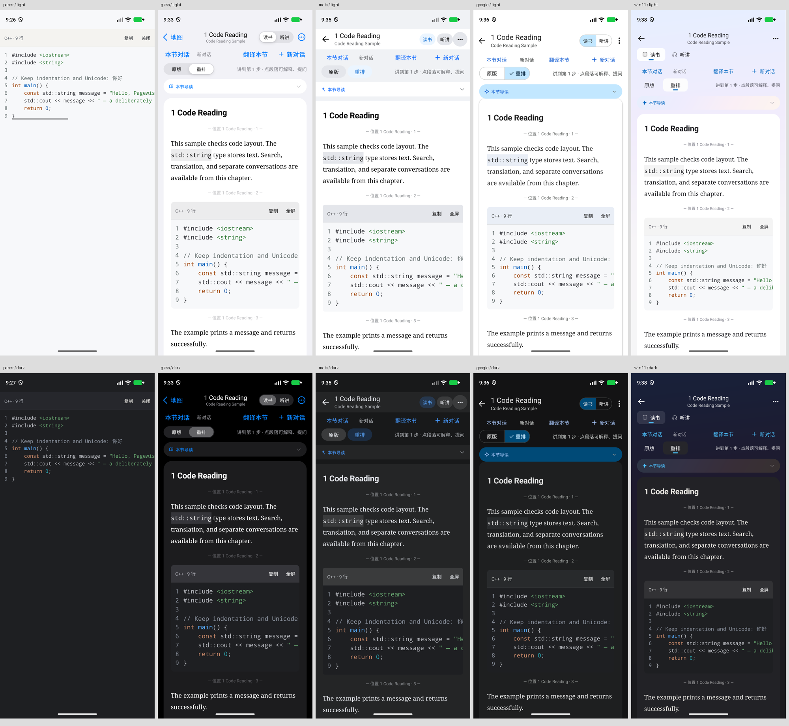

# 阅读与 AI 功能验证（2026-10-30）

分支：`codex/feature-reader-ai-enhancements`。以 main 的 `a1da0bc` 为基础，已包含 `313a733` 与 `a1da0bc` 两次合并。

## 功能

1. 页面、对话输入区、Dialog 和 Sheet 的输入框适应键盘；滚动只响应当前容器里的焦点。
2. 模型目录提取搜索、工具、图像/音频/视频、推理档位与上下文能力；刷新保留用户手工覆盖。
3. 每个章节拥有独立对话、进度和选项；首页与书架显示对话所属书籍、章节与消息数。旧消息迁入原有对话。
4. 整节翻译按全文分批处理，保留代码和独立公式，成功后缓存；取消、错误与截断不缓存部分译文。
5. 对话、讲解、翻译和问书架均可选模型、推理强度与内置搜索；选项受模型能力限制。搜索来源使用供应商返回的真实链接。
6. 原书与 AI 回复共用代码阅读组件：保留语言、缩进、空行，显示等宽字体、语法高亮、固定行号、横向滚动，支持复制和全屏阅读。兼容已经入库且包含围栏的代码。

## 自动检查

- Node 24.22.0：`npm run check` 通过，包含 ESLint、TypeScript 与 Jest。
- 100 个测试套件通过；1,915 个测试通过，2 个既有测试跳过；15 个快照通过。
- 重点覆盖旧数据库升级、章节/对话隔离、恢复选中对话及模型选项、翻译完整性与取消、三种协议的实际请求参数、代码文本保真与行内代码。
- 5 套皮肤 × 深浅色覆盖代码复制/全屏关闭、对话跳转、模型/推理/搜索控件及不支持能力时的禁用状态；翻译弹层覆盖全部皮肤。
- Android arm64 debug 构建成功，包含新增的原生剪贴板模块。

## Android 界面检查

使用任务专属 Pixel 10 Pro 模拟器（1280 × 2856），没有修改原书库。代码示例为本地生成的英文 EPUB；对话和翻译交互使用内存演示书库。

- 纸感、苹果风、Meta 风、新谷歌风、Win11 风均检查深浅色代码阅读与操作栏。
- 代码左右滚动时行号固定；复制显示成功反馈；全屏支持关闭和系统返回。
- 系统字号 1.3 下检查代码和操作按钮；结束时恢复字号与深浅色设置。
- 新建对话显示空消息，输入区与发送按钮位于键盘上方；发送后按首个问题命名。
- 切回旧对话恢复原消息、推理强度和搜索开关；本节翻译弹层显示并使用当前选项。
- 设置表单与闪卡编辑 Sheet 的焦点输入在键盘上方可见。

真实供应商的目录、联网与翻译参数通过协议夹具验证，没有调用用户的付费 Key；此检查不评价在线模型的翻译质量。

